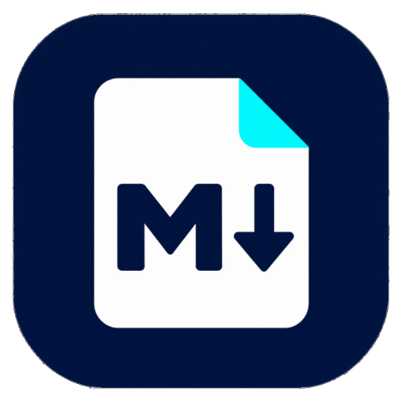

<p align="center"></p>

# MarkdownApp

A simple Markdown editor and viewer for Windows: editor on the left, live preview on the right.
Works fully offline.

## Features

- Live preview of GitHub-flavored Markdown: tables, task lists, fenced code, strikethrough, heading anchors
- Split, editor-only and preview-only views, with a draggable divider and optional scroll sync
- Open, save, Save As, recent files, drag-and-drop, and "Open with" from Explorer
- Prompts before discarding unsaved changes
- Light and dark theme following the Windows setting
- Built-in Markdown syntax guide (F1)
- Relative images and links resolve against the open file's folder; web links open in your browser

## Keyboard shortcuts

| Action | Keys |
|---|---|
| New / Open / Save / Save As | Ctrl+N / Ctrl+O / Ctrl+S / Ctrl+Shift+S |
| Bold / Italic / Link / Inline code | Ctrl+B / Ctrl+I / Ctrl+K / Ctrl+` |
| Split / Editor only / Preview only | Ctrl+1 / Ctrl+2 / Ctrl+3 |
| Zoom in / out / reset | Ctrl+= / Ctrl+- / Ctrl+0 |
| Indent / Outdent | Tab / Shift+Tab |
| Markdown syntax guide | F1 |

## Security

- Rendered HTML is sanitized with [DOMPurify](https://github.com/cure53/DOMPurify); a Content Security Policy blocks scripts in documents.
- The renderer is sandboxed with context isolation and no Node.js access.
- The page cannot choose file paths: saving writes only to the open file or a path picked in the Save As dialog, and opening files outside the Open dialog requires a one-time grant from the main process tied to real user input.

## Download

Get the latest version from the [Releases](https://github.com/hironaka-codehub/MarkdownApp/releases/latest) page
(Windows 10/11, 64-bit):

| File | Use it if… |
|---|---|
| `MarkdownApp-<version>-setup.exe` | You want it installed: Start menu and desktop shortcuts, opens `.md` files on double-click, uninstall from **Settings → Apps**. No admin rights needed. |
| `MarkdownApp-<version>-portable.exe` | You want a single file with no installation, e.g. on a USB stick. Starts a little slower. |

The files are not code-signed, so Windows may show **"Windows protected your PC"** the first time.
Click **More info → Run anyway**.

## Getting started (from source)

### Requirements

- Windows 10 or 11 (64-bit)
- [Node.js](https://nodejs.org/) **22.12 or newer** (the current LTS works)
- [Git](https://git-scm.com/) (optional; you can use **Code → Download ZIP** instead)

### Run

```powershell
git clone https://github.com/hironaka-codehub/MarkdownApp.git
cd MarkdownApp
npm install
npm start
```

`npm install` downloads Electron (about 100 MB) the first time. To open a specific file:
`npm start -- path\to\file.md`

## Build

There are three ways to ship the app:

| Command | Output | Notes |
|---|---|---|
| `npm run package` | `dist\MarkdownApp-win32-x64\` | A folder; `MarkdownApp.exe` needs the whole folder next to it. |
| `npm run build:portable` | `release\portable\MarkdownApp-<version>-portable.exe` | One file, no install. Unpacks itself to a temp folder on each launch, so startup is slower. |
| `npm run build:installer` | `release\installer\MarkdownApp-<version>-setup.exe` | Per-user installer (no admin needed). Adds Start menu and desktop shortcuts, registers `.md`/`.markdown` files, and has an uninstaller in Windows Settings → Apps. |

All three keep settings in `%APPDATA%\MarkdownApp`. The builds are not code-signed, so Windows
SmartScreen may warn on first run ("More info → Run anyway").

For the folder build, to open `.md` files from Explorer use **Open with → Choose another app → MarkdownApp.exe**.
